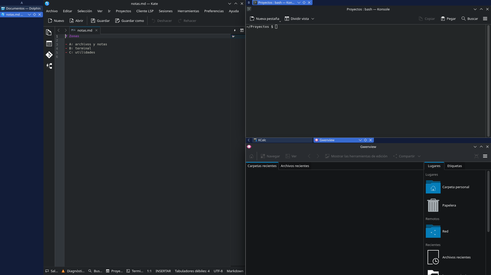
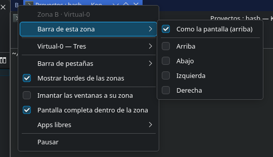

# ScreenZones

Divide cada pantalla en zonas fijas que se comportan como monitores independientes. Cada zona tiene su barra de pestañas con sus ventanas, y cada ventana conserva su tamaño dentro de su zona.

Tiene una versión para KDE Plasma 6, en `linux/`, y otra para la barra de menú de macOS, en `macos/`.

## Linux





### Requisitos

- KDE Plasma 6 en Wayland
- `qdbus6`, que viene con las herramientas de Qt 6 (`qt6-tools` en Arch)
- CachyOS, la única distribución probada

### Instalar

```bash
curl -LO https://github.com/swtnicolas/screen-zones/releases/latest/download/screenzones-install.sh
bash screenzones-install.sh
```

El icono de ScreenZones aparece en la bandeja del sistema y abre el menú: zonas por pantalla, disposiciones, editor y posición de las barras. El clic derecho sobre la letra de una zona o sobre una pestaña abre su propio menú.

### Actualizar

```bash
curl -LO https://github.com/swtnicolas/screen-zones/releases/latest/download/screenzones-install.sh
bash screenzones-install.sh
```

Las zonas, disposiciones y reglas se conservan.

### Desinstalar

```bash
bash screenzones-install.sh --uninstall
```

La configuración queda en `~/.config/screenzonesrc`; para borrarla también:

```bash
rm ~/.config/screenzonesrc
```

### Instalar desde el código

```bash
bash linux/scripts/install.sh
```

No requiere compilar. `bash linux/scripts/test.sh` corre las pruebas unitarias (Node 22) y `bash linux/scripts/package.sh` genera `linux/dist/screenzones-install.sh`.

## macOS

No hay descarga para Mac: la app se compila en el propio equipo, porque macOS bloquea una copia descargada sin firma de Apple.

### Requisitos

- Mac con Apple Silicon
- macOS 27.2, la única versión probada
- Command Line Tools de Xcode (`xcode-select --install`)

### Instalar

```bash
git clone https://github.com/swtnicolas/screen-zones.git
bash screen-zones/macos/scripts/install.sh
```

Compila la app, la copia en `~/Applications/ScreenZones.app`, la abre y hace que se abra al iniciar sesión. La primera vez pide el permiso de Accesibilidad, en Ajustes del Sistema › Privacidad y seguridad › Accesibilidad.

El icono de ScreenZones aparece en la barra de menú y abre el mismo menú que en Linux. El clic derecho sobre la letra de una zona o sobre una pestaña abre su propio menú.

### Actualizar

```bash
git -C screen-zones pull
bash screen-zones/macos/scripts/install.sh
```

Las zonas, disposiciones y reglas se conservan. Cada compilación lleva una firma nueva, así que macOS vuelve a pedir el permiso de Accesibilidad, salvo que el llavero tenga un certificado de firma de código llamado "Nico Local".

### Desinstalar

```bash
bash screen-zones/macos/scripts/uninstall.sh
```

Para borrar también la configuración:

```bash
defaults delete local.screenzones
```

El permiso de Accesibilidad se quita en Ajustes del Sistema › Privacidad y seguridad › Accesibilidad.
